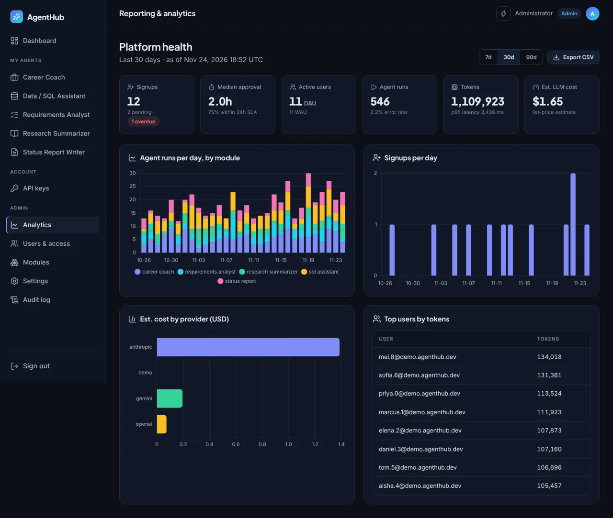
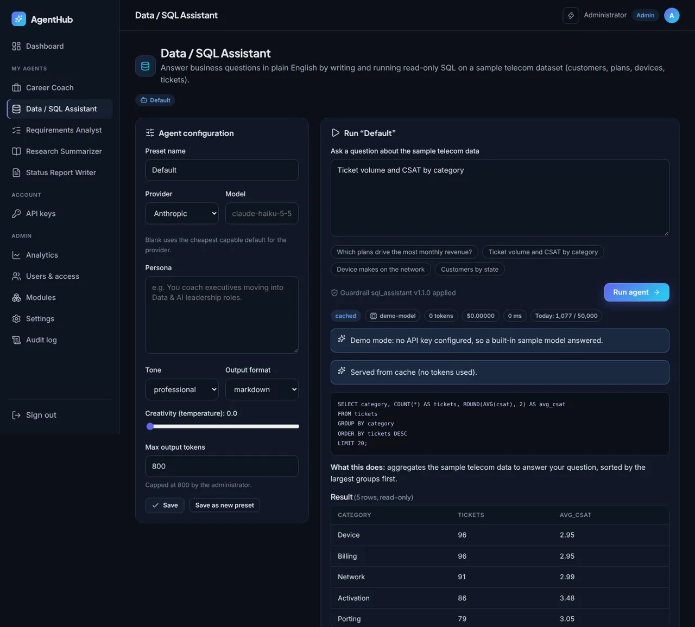
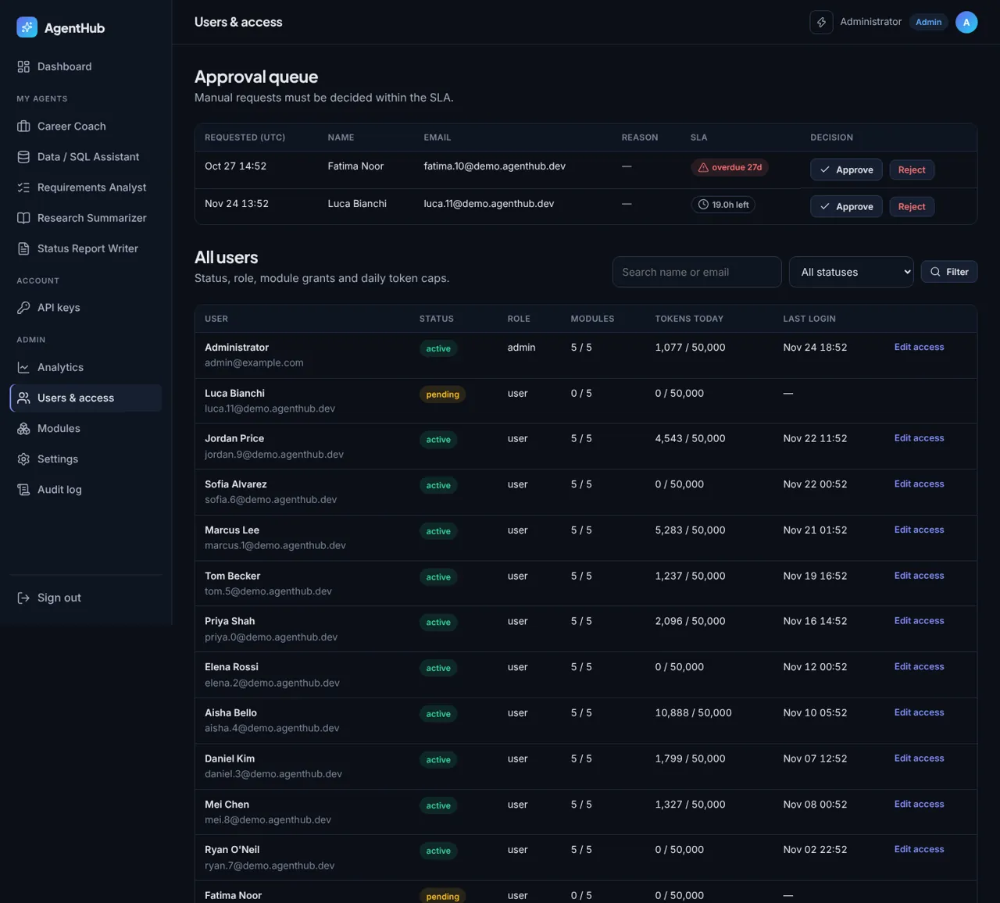
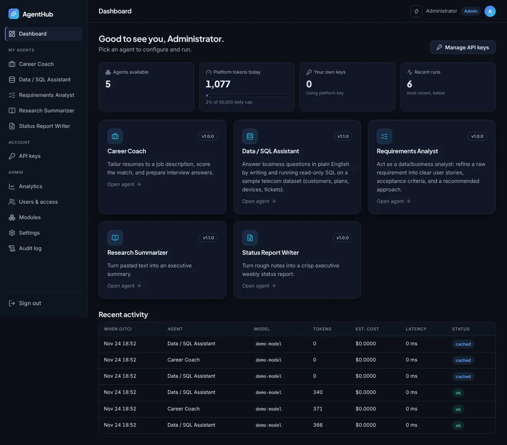
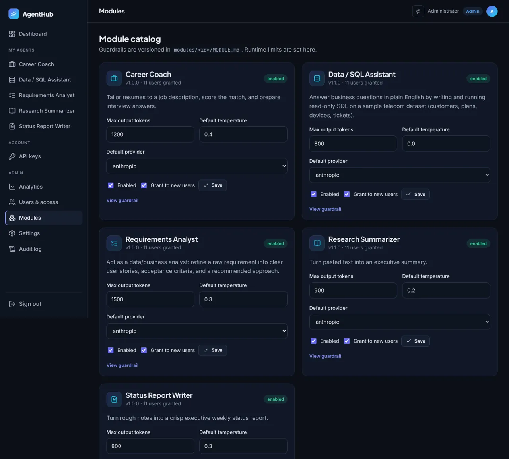
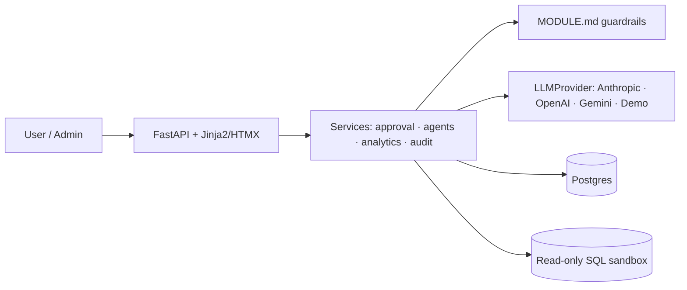

# AgentHub

**A governed, multi-model AI agent platform.** Approved users configure purpose-built agents for career coaching, research, data/SQL, status reporting and requirements analysis. Admins control access, cost and audit. Built end to end with a gated SDLC and deployed GitHub → Replit.

*By Varghese Pathisseril*

> **Status: v1.0.** Live link: `https://<your-app>.replit.app` (add after deploying; see [Runbook](docs/05-runbook.md)).



## Why it matters
| Leadership concern | How AgentHub answers it |
| --- | --- |
| **Governance** | Auto or manual approval with a 24h SLA, RBAC, per-module grants, full audit log |
| **Safety** | Guardrails as code (`MODULE.md`), prompt-injection defences, escaped output, read-only SQL sandbox |
| **Cost** | Per-user daily token caps, model tiering, 10-minute cache, cost per run/module/provider |
| **Choice** | Anthropic, OpenAI and Gemini behind one interface; platform key or bring-your-own (encrypted) |
| **Evidence** | Gherkin AC → 66 automated tests (95% coverage), CI gates, threat model, ADRs |

## Features
- **Landing and signup** with instant auto-approval or manual review (24h SLA countdown, breach flagging, optional auto-approve on breach)
- **Agent Builder**: provider, model, persona, tone, output format, temperature, max tokens (clamped by admin), saved presets
- **Five starter modules**: Career Coach · Research Summarizer · Data/SQL Assistant (runs read-only SQL on a telecom sample) · Status Report Writer · Requirements Analyst
- **Admin console**: approval queue, user status/role/caps/grants, module catalog and limits, platform settings, audit log
- **Reporting and analytics**: signups, median approval time and % within SLA, DAU/WAU, runs, tokens, estimated cost, error rate, p95 latency; charts; CSV export
- **Demo mode**: with no API keys, a built-in sample model answers, so the product can always be shown at zero cost

| Agent run (SQL) | Approval queue and access |
| --- | --- |
|  |  |
| **User dashboard** | **Module catalog with guardrails** |
|  |  |

## Architecture

Details: [Design](docs/02-design.md) · [Security](docs/04-security.md) · [ADRs](docs/adr/)

## Quick start (local)
```bash
python -m venv .venv && source .venv/bin/activate
pip install -r requirements.txt
cp .env.example .env        # set ADMIN_PASSWORD (and SECRET_KEY)
python -m scripts.seed_demo # optional: 30 days of demo analytics
uvicorn app.main:app --reload   # http://localhost:8000
```
Sign in with `ADMIN_EMAIL` / `ADMIN_PASSWORD`. Demo users use the password `Demo-User-Pass-1`.

**Quality gates:** `pytest --cov=app && ruff check . && mypy && bandit -q -r app -c pyproject.toml && pip-audit -r requirements.txt`

## Deploy (GitHub → Replit)
Push to GitHub → Replit: **Import from GitHub** → add Postgres → set Secrets → **Run** → **Deploy (Autoscale)** → `python -m scripts.smoke <url>`. The step-by-step guide is in the [Runbook](docs/05-runbook.md).

## How I built it (SDLC)
| Phase | Deliverable | Tag |
| --- | --- | --- |
| 0 Setup | Skeleton, `CLAUDE.md` master guardrail, `MODULE.md` stubs, CI | v0.0 |
| 1 Requirements | Personas, INVEST stories, Gherkin AC, NFRs, traceability ([01](docs/01-requirements.md)) | v0.1 |
| 2 Design | C4, ERD, sequences, route map, ADRs, STRIDE ([02](docs/02-design.md), [04](docs/04-security.md)) | v0.2 |
| 3 Core build | Auth, approval + SLA, RBAC, CSRF, rate limits, security headers, landing | v0.3 |
| 4 Agents and modules | LLM layer (3 providers + demo), registry, Agent Builder, BYOK, SQL sandbox | v0.4 |
| 5 Admin and analytics | Admin console, KPIs, charts, CSV, audit, demo seed | v0.5 |
| 6 Quality and security | 66 tests (95% coverage), mypy --strict, bandit, pip-audit, UI review ([03](docs/03-test-plan.md)) | v0.6 |
| 7 Deploy | Alembic migrations (verified on Postgres 16), `.replit`, runbook, smoke test | v1.0 |

## Stack
Python 3.12 · FastAPI · SQLAlchemy 2 / Alembic · Postgres · Jinja2 + HTMX · token-based CSS (Executive Slate theme) · Lucide icons · Chart.js · argon2 · Fernet · pytest · ruff · mypy · bandit · pip-audit · gitleaks · GitHub Actions · Replit

## Standards
OWASP Top 10 (2021) · OWASP ASVS L1 · OWASP Top 10 for LLM Applications · WCAG 2.2 AA · 12-Factor App · Conventional Commits · SemVer · C4 model · INVEST + Gherkin · NIST AI RMF (framing)
