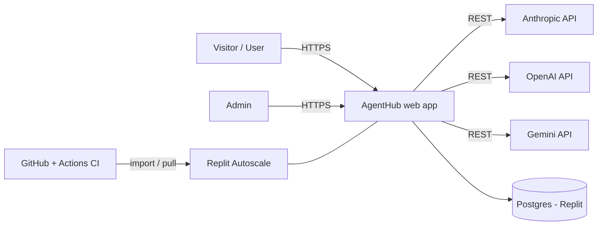
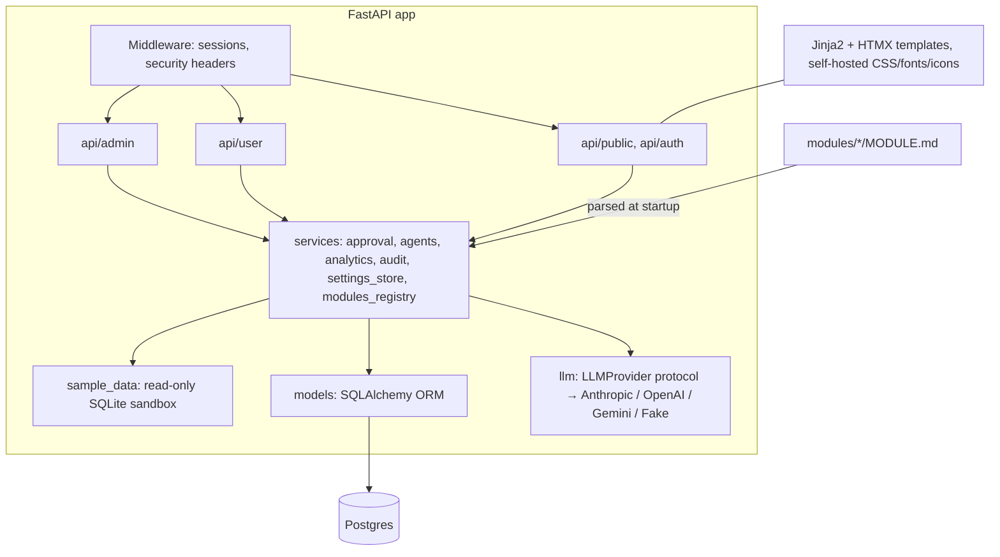
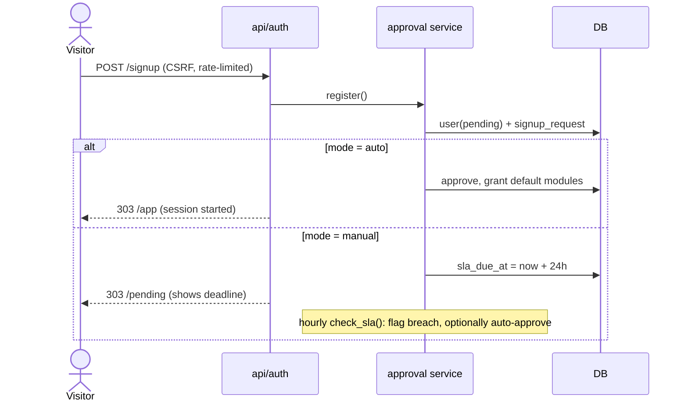
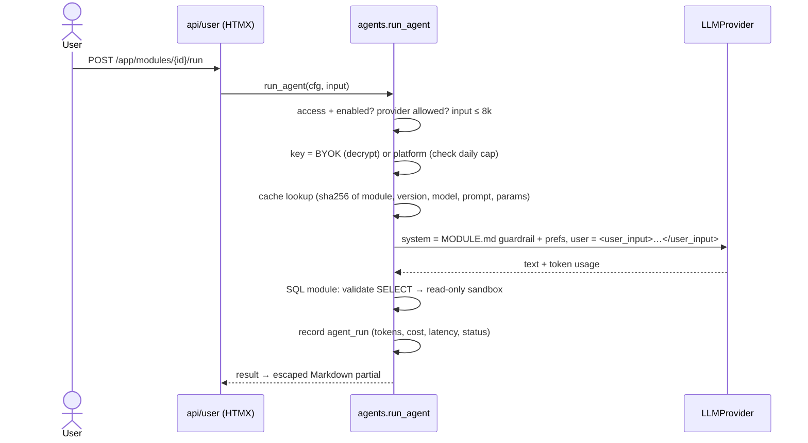

# 02 — Design

## C4: context


## C4: containers and components


## ERD
```mermaid
erDiagram
  users ||--o{ signup_requests : requests
  users ||--o{ user_module_access : granted
  modules ||--o{ user_module_access : grants
  users ||--o{ agent_configs : owns
  modules ||--o{ agent_configs : configures
  users ||--o{ agent_runs : runs
  users ||--o{ api_keys : "BYOK (encrypted)"
  users { int id PK; string email UK; string role; string status; int daily_token_cap }
  signup_requests { int id PK; int user_id FK; string mode; string status; datetime requested_at; datetime sla_due_at; datetime decided_at; string decided_by; bool sla_breached }
  modules { string id PK; string name; string version; bool enabled; bool default_for_new_users; int max_tokens; float temperature; string default_provider }
  agent_configs { int id PK; int user_id FK; string module_id FK; string provider; string model; text persona; string tone; string output_format; float temperature; int max_tokens }
  agent_runs { int id PK; int user_id FK; string module_id; string provider; string model; string key_source; int tokens_in; int tokens_out; float est_cost_usd; int latency_ms; string status }
  api_keys { int id PK; int user_id FK; string provider; text encrypted_key; string last4 }
  audit_log { int id PK; string actor; string action; string target; text detail }
  settings { string key PK; text value }
```

## Sequence: signup and approval


## Sequence: agent run


## Route map
| Area | Routes | Guard |
| --- | --- | --- |
| Public | `GET /`, `GET /health`, `GET/POST /signup`, `GET/POST /login`, `GET /pending`, `POST /logout` | CSRF on POST; rate limits on signup/login |
| User | `GET /app`, `GET /app/modules/{id}`, `POST …/config`, `POST …/run`, `GET /app/settings`, `POST /app/settings/keys[/…/delete]` | `current_user` + module grant check; run is rate-limited |
| Admin | `GET /admin`, `/admin/analytics.csv`, `/admin/users`, `POST /admin/requests/{id}/approve|reject`, `POST /admin/users/{id}`, `/admin/modules`, `/admin/settings`, `/admin/audit` | Router-level `require_admin` + CSRF |

RBAC is enforced by FastAPI dependencies (`current_user`, `require_role("admin")`) attached at the router level, never inline.

## Architecture decision records
See `docs/adr/`:
- ADR-001: HTMX + server templates instead of an SPA
- ADR-002: Postgres on Replit, SQLite for tests
- ADR-003: Hybrid key model (platform key with caps, plus BYOK)
- ADR-004: MODULE.md as the runtime guardrail
- ADR-005: Prototype deviations from the original plan (no Tailwind/Alpine, no URL fetch, no streaming)
